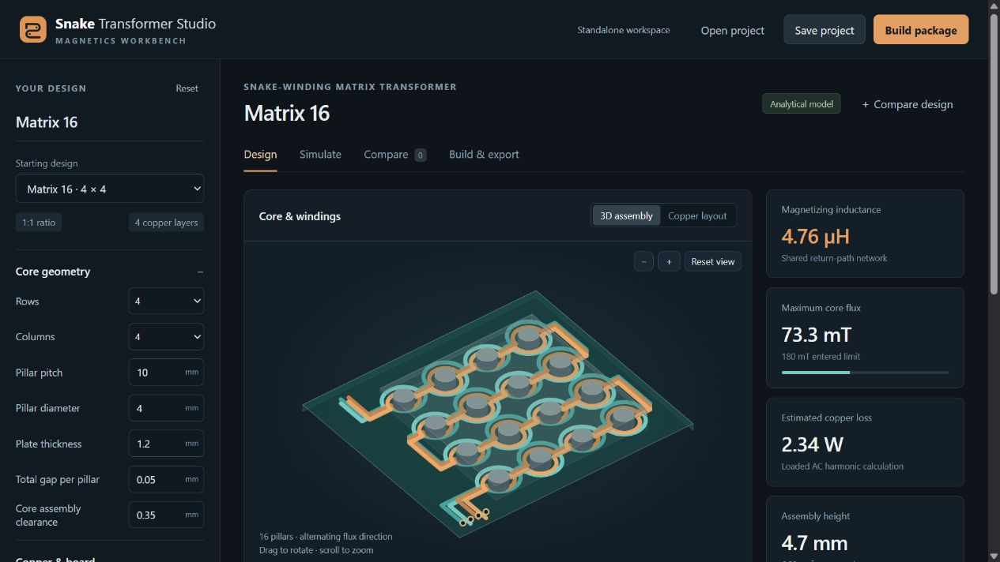

# Snake Transformer Studio

A focused local workbench for PCB snake-winding matrix transformers. Design the magnetic assembly and connected copper, inspect analytical simulations, compare candidates, and export a complete project. Available as a standalone browser application and a separate KiCad IPC plugin.



Version 0.1.0 is an engineering prototype. It supports **1:1 windings with one signed turn around each pillar**, **four copper layers**, and **2×2, 2×4, 4×2 or 4×4 pillar grids**. These boundaries are enforced; arbitrary turns ratios and series/parallel matrix networks are not implemented.

## Run standalone

Extract the standalone ZIP into a folder you own. On Windows, double-click **Start Snake Transformer Studio.cmd**; on macOS/Linux run `sh "Start Snake Transformer Studio.sh"`. Python 3.9 or newer is required. The launcher opens the local application in your browser. No Python packages or network connection are needed for standalone use.

Or run from the extracted folder:

```sh
python ipc_entry.py --no-browser --port 8765
```

Open the printed local URL. The server binds to the loopback interface, uses a session token for API requests, and serves the application locally. Stop the server with Ctrl+C. The standalone launcher terminal needs to remain running while you use the app.

Projects and comparisons auto-save to the local server's data directory. A browser-storage draft is also kept as a fallback. **Save project** writes a portable `.snake.json` file, which is the durable way to transfer or archive a design. Settings and exports are isolated from Planar Studio. `SNAKE_TRANSFORMER_STUDIO_HOME` overrides the application's data directory.

## Install the KiCad plugin

In KiCad's **Plugin and Content Manager**, choose **Install from File** and select the separate `snake-transformer-studio-0.1.0-kicad.zip`. Restart KiCad if requested. Enable the **IPC API** in KiCad preferences and open PCB Editor. Start **Snake Transformer Studio** from the plugin actions.

The plugin targets KiCad 9.0.1+ and uses `kicad-python`; KiCad manages that dependency for the IPC plugin. KiCad 10 CLI is used for the supplied board-export checks. Interactive placement must be verified against your installed KiCad; a successful export check is not a test of a live IPC session.

Standalone and plugin use the same project format and UI. Their app IDs and data directories are separate from the original Planar Studio, so both can be installed.

## Design workflow

1. Choose **Matrix 16**, **Bench 4**, or **Slim 8** as a starting point.
2. Set core pitch, pillar diameter, plate thickness, assembly clearance and the total gap per pillar. Assembly clearance sets both the radial fit around a pillar and the axial clearance above and below the PCB.
3. Set trace width, copper clearance, copper weight and PCB thickness. The generator builds complementary snake layers, verifies complete signed linkage around every pillar, and checks crossings and plated barrels on every layer.
4. Set frequency, drive voltage and target load power. Square-wave voltage is bipolar amplitude; sine-wave voltage is RMS. Target power defines a resistive load at the ideal output voltage; predicted loaded power can differ.
5. Inspect **Simulate** for currents, inductance, leakage, AC copper loss, frequency response, regional flux and approximate winding fields. Enter operating-point material loss data and an assembly thermal resistance to obtain a total-loss and temperature estimate.
6. Pin up to four designs under **Compare**, or explore nearby pillar pitches and plate thicknesses. Candidate ranking considers estimated copper loss only.
7. Use **Build & export** for the full ZIP and report. Inspect the resulting board with KiCad's own design-rule checker before fabrication.

In the 3D assembly, drag to rotate, scroll to zoom, toggle either winding or core, and use **Explode** to inspect the layer stack. **Copper layout** shows the generated physical paths from above.

Measured primary AC resistance can be overlaid on the frequency plot using CSV:

```csv
frequency_hz,rac_ohm
100000,0.21
200000,0.25
800000,0.61
```

These numbers are format examples, not measurements of a real transformer. The plotted analytical Rac is the copper-only resistance-matrix diagonal with the other winding's current zero. Measured input resistance needs fixture and core-loss correction before comparison. Loaded copper loss uses both windings and their cross terms. Changing the design clears its measurement overlay; changes that affect the core operating point also clear entered core-loss density.

## What is in a build package?

- `.snake.json`: complete editable inputs.
- `.kicad_pcb`: routable winding tracks, named nets, plated connections, four-layer physical stack, board outline and individual core openings.
- `.kicad_dru`: copper and board-edge clearance rules matching this design. Keep it beside the board with the same base name.
- `.kicad_mod`: reusable graphical copper footprint; use the PCB export for electrical routing and DRC.
- `.svg` and `.dxf`: winding artwork.
- `-core-plate.stl` and `-core-pillar.stl`: nominal mechanical solids in millimetres.
- `-core-assembly.json`: quantities, positions and dimensions for two return plates and the pillar grid.
- `-report.html`: printable layout, results, checks, all inputs and assumptions.
- `-analysis.json`: machine-readable simulation results, including magnetic network and field diagnostics.

STL exports define shape, not a ferrite grade or fabrication process. Specify material, tolerances, gap preparation, fixtures, insulation and assembly with the supplier. The exact material in the linked research prototype has not been verified.

For live KiCad placement, the destination PCB must already have all four copper layers, the two named nets and matching core openings. Set the origin in **Build & export**, then choose **Check & place copper**. The tool reads a fresh board snapshot, checks clearance and cutouts, validates layer/net mapping and inserts copper as a new grouped operation. It does not silently delete an existing design. Exporting a complete board is the simplest first-use path.

## Models and boundaries

The magnetic model uses separate top and bottom magnetic-potential nodes at each pillar, with pillar/gap reluctances and shared return-plate branches. It solves flux conservation and signed winding linkage instead of treating the whole structure as a single generic core.

Copper loss uses routed conductor lengths, a local four-layer foil approximation, and the full resistance matrix. The coupled load circuit supports sinusoidal drive and a 16-odd-harmonic approximation for bipolar square drive. Frequency sweeps recompute the circuit and copper losses. Thermal results use an entered lumped thermal resistance.

This is **not a 3D finite-element solver**. It does not model nonlinear saturation, DC bias, gap fringing, bend/terminal eddy currents, parasitic capacitance, resonances, rectifiers, switching losses, closed-loop converters or detailed thermal hotspots. It has not been calibrated against the video prototype or physical hardware. Core loss, total efficiency and temperature are explicitly **Unknown** without the required material/thermal inputs. A measured core-loss density is valid only at its entered operating point; it is not reused across a sweep or a changed candidate geometry.

See [the model reference](docs/snake-models.md) for equations, units, assumptions and numerical validation.

## Development and verification

The UI is native JavaScript, CSS and SVG, with no build-time frontend framework. The local server uses Python's standard library. The optional live KiCad connection uses `kicad-python`.

```sh
npm test
python -m unittest discover -s tests -p test_snake_package.py
python scripts/build_snake_package.py --output-dir dist
```

`npm test` exercises the snake geometry, analytical physics and project/export I/O. Python tests cover package metadata, server authentication, standalone operation, data isolation and backend placement validation. KiCad CLI checks are separate integration checks; they require KiCad to be installed.

## Sources and license

Based on [Jonah Saunders's Planar Studio](https://github.com/jonahsaunders/planar-studio), upstream revision `0ef077898a9e2ab8689aa1481984faa3b62f406d`, under the [MIT license](LICENSE). This derivative retains the shared artwork exporters, geometry utilities, local server and KiCad bridge, while replacing the general-purpose interface with the focused snake workbench.

The design concept comes from [Hans Wouters's 2026 KU Leuven thesis](https://lirias.kuleuven.be/4432772) and [the linked video](https://www.youtube.com/watch?v=y5rKlyQ3TDo). This is an independent implementation of a bounded snake-matrix topology, not an official research release or a reproduction of the measured hardware.
